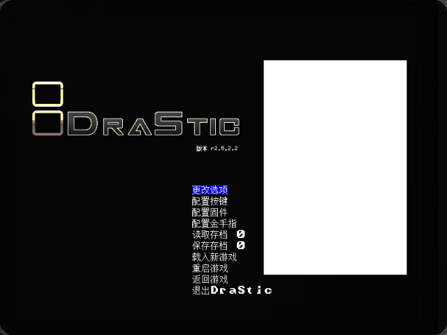
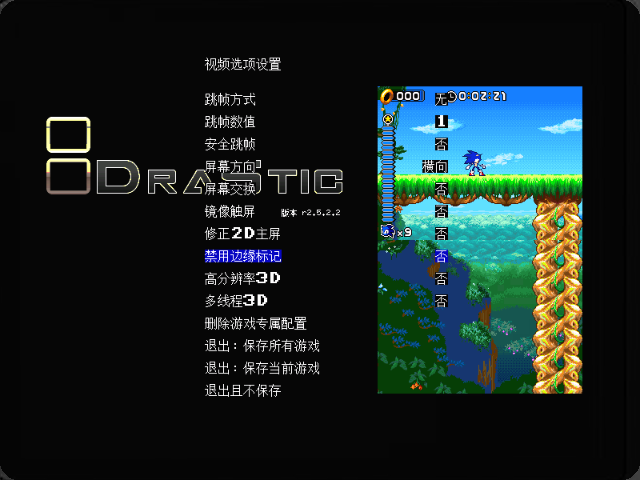
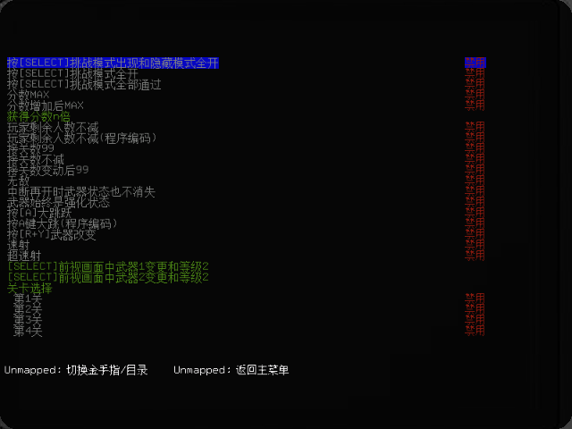

# drastic-cjk

给 **Anbernic RG DS**（安伯尼克双屏掌机）上运行于 **ROCKNIX** 的 **DraStic**
（NDS 模拟器）菜单加中文字体支持。

它是一个**二进制注入工具链**：读取你自己那份未经修改的 `drastic`，在 ELF 里"借用"一个
程序头，塞进一层中文渲染代码 + 字库 + 翻译表，产出一个可运行的新可执行文件。
原版程序的代码段**一个字节都不改**（除了两个函数入口各 4 字节的跳转）。

> 本项目**不包含**也不下载原版 `drastic`。你需要自备合法副本，见 [NOTICE.md](NOTICE.md)。

---

## 来源与验证

| 项目 | 说明 |
|---|---|
| 目标设备 | **Anbernic RG DS**（安伯尼克，双屏掌机） |
| 目标系统 | **ROCKNIX RK3566**，构建版本 **20261001**（Linux，AArch64，用户态页大小 4096） |
| 系统镜像 | `ROCKNIX-RK3566.aarch64-20261001-Specific.img.gz` |
| 原版来源 | 从上述系统镜像里提取的 `drastic`，**未经任何修改** |
| 原版 md5 | `3e5a8b427561b9473751869de22cb40b`（1 411 544 字节） |
| 实机验证 | 打补丁后的 `drastic.cjk` 已在 **Anbernic RG DS 真机**上跑通 —— 中文菜单显示、游戏启动、金手指列表均验证通过（验证的就是本仓库的参考构建，md5 `373b50bfde2112438b37c968073ff853`）；下面「效果」里的三张图即该次实拍 |

本工具链是对着这一个具体版本的地址硬编码写的（见 [docs/BUILD.md](docs/BUILD.md) 第 0 节的
md5 校验）。补丁只回收一个 `PT_NOTE` 程序头、改两个函数入口的跳转，**不引入新的动态依赖**，
所以替换后仍与 ROCKNIX 自有用户态兼容，可直接在设备上运行。

---

## 效果

**① 主菜单** —— 全部菜单项已汉化，中英混排基线一致：



**② 视频选项** —— 在两列网格里重排，中文标签与数值列对齐：



**③ 金手指列表** —— 条目名称与「启用 / 禁用」状态列全部汉化，底部按键提示的动作文字同样替换为中文：



在 800×480 的画布上把菜单重排成 200% 网格（16 px 字符格），并接管所有文本绘制：

- 主菜单、更改选项、视频选项、配置固件、配置按键、额外按键、金手指列表**全部汉化**
- 中文用 **GNU Unifont 位图字模**（15×15 / 10×10 / 8×8 / 16×16 四套，按宿主字体高度自动选择）
- 纯 ASCII 走宿主自带的 8×8 字模**按需放大 2 倍**，保证中英混排基线一致
- 修好了原版"配置按键"页面与"额外按键"子页共用渲染尾、导致第二页错位的歧义
- 喜爱颜色色块、数值列对齐、光标高亮框按新的 16 px 网格重新锚定

## 快速开始

```sh
# 依赖：Python 3.8+、zig（pip install ziglang）、capstone
pip install ziglang capstone                 # 两个都是构建必需：capstone 给 patch.py 查 ARM64 寄存器编号

# 指向你自己那份原版程序
export DRASTIC_SRC=/path/to/drastic

./build.sh                                   # -> build/drastic.cjk
python3 tools/verify.py build/drastic.cjk    # 结构自检 + 与参考构建比对
```

产物 `build/drastic.cjk` 就是打了补丁的完整可执行文件。**它必须重命名回 `drastic`
才能替换原来的可执行文件** —— 系统启动的是 `drastic` 这个名字，`.cjk` 后缀只是用来
区分"补丁版"的标记：

```sh
# 主机 -> 设备（叫什么都行，先留着 .cjk 以免直接覆盖原版）
scp build/drastic.cjk root@<device>:/storage/.config/drastic/

# 设备上：备份原版，再重命名顶替
cd /storage/.config/drastic
cp drastic drastic.orig.bak      # 留一份原版，出问题能一键还原
mv drastic.cjk drastic           # ← 重命名 + 替换，这一步不能省
chmod 755 drastic                # 少了执行位会启动失败
```

详细步骤见 **[docs/BUILD.md](docs/BUILD.md)**，原理见 **[docs/INTERNALS.md](docs/INTERNALS.md)**。

## 仓库结构

```
src/                 注入层本体（交叉编译成一段 R-X payload）
  cjk.c              中文渲染、菜单网格、页面/行表、色块锚定（约 1000 行）
  entry.S            draw_text() / fill_rect() 两个入口桩
  syms.S             宿主程序内部符号（模块相对地址）
  link.ld            链接脚本：把 payload 钉在 0x150000
tools/               主机端工具（纯 Python）
  patch.py           打补丁：改程序头、写跳转、重定向字符串引用、拼字库
  genmenu.py         由原版字符串偏移生成 menu.bin + menu_sites.py
  unifont.py         GNU Unifont .hex 位图源（16×16 字形格）
  unifont_subset.py  从上游 .hex 裁出 GB2312 子集（assets/unifont.hex）
  genfont5.py        15/10/8 三套 CJK 位图字模（Unifont 16×16 降采样）
  genfont6.py        16×16 CJK 字模 + 2× ASCII 对照件
  genfont_uni.py     GB2312 → Unicode 映射表
  gen_rowtab.py      由厂商菜单树反推 ROWTAB（依赖 harness）
  verify.py          产物结构自检
assets/              生成好的二进制资源（已提交，保证可复现；见 assets/README.md）
harness/             Unicorn 模拟器验证工具（可选，见 harness/README.md）
docs/                编译教程、注入原理与真机截图
build.sh             一键构建
gen-assets.sh        重新生成 assets/ 全部资源
```

## 可复现性

参考构建的产物是：

```
size 2 403 166 bytes
md5  373b50bfde2112438b37c968073ff853
```

在干净的工作区里 `./build.sh` 应当得到**完全相同**的 md5。已验证：

- `assets/` 下的资源全部能从零重新生成，逐字节一致
- payload 编译 → 打补丁全流程重跑，输出 md5 不变

上游若改动 `src/` 或 `assets/` 导致 md5 变化，请同步更新
`tools/verify.py` 里的 `REFERENCE_MD5`，并在 `docs/BUILD.md` 记录原因。

## 已知限制

- 只针对 **AArch64 / PIE** 的 Linux 版；x86、Android 版结构不同，不适用
- 只汉化了菜单 UI；游戏内文本、金手指内容依赖游戏自身
- 中文字符集为 **GB2312**（8837 个码位），生僻字会显示成空心方框
- 字体是点阵：16×16 / 15×15 两套是上游字形的直接拷贝或近 1:1 缩放，
  10×10 与 8×8 由 16×16 降采样而来，笔画细、结构不如两套大字号
- 注入段只有 8 KB 代码空间（已用 838 B），改大改动前先看 `docs/INTERNALS.md`
  里的空间预算表

## 许可

源码 MIT（见 [LICENSE](LICENSE)）；中文字模来自 **GNU Unifont**，按 **SIL Open
Font License 1.1** 分发（`assets/OFL-1.1.txt`），**不属于** MIT 部分。原版程序的
来源见 [NOTICE.md](NOTICE.md)。本项目与原程序的作者无关，请勿分发原版或打补丁后的
二进制。
